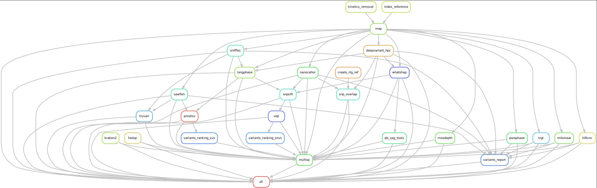
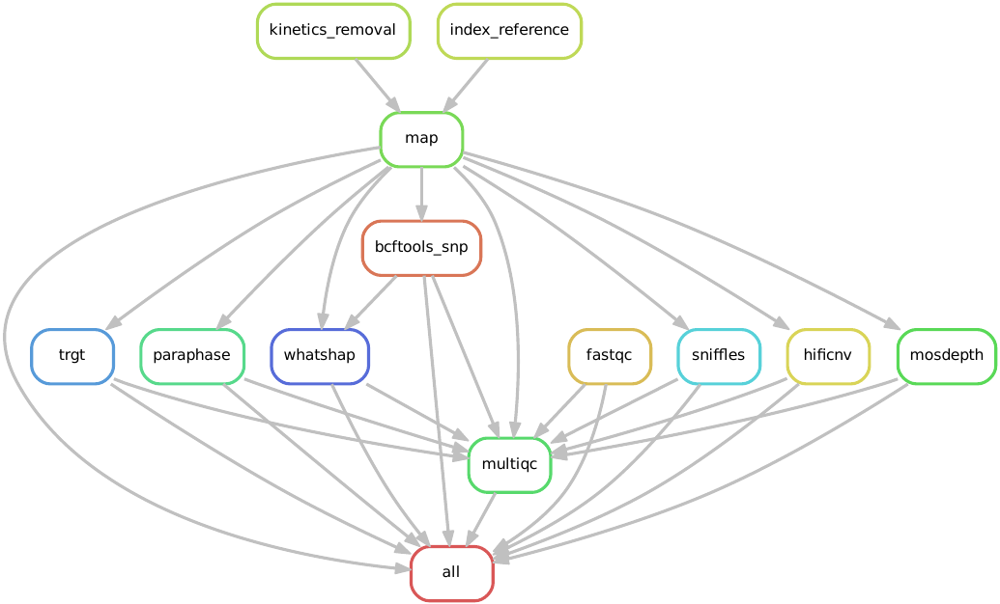
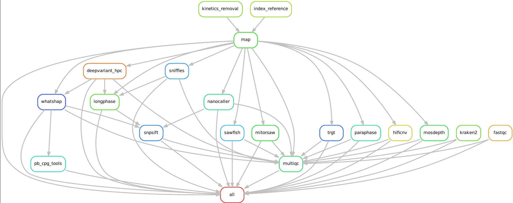

# pb_variants 

    # PacBio HiFi Variant Analysis Pipeline

A Snakemake 9 pipeline for PacBio HiFi sequencing data, providing alignment, small-variant and structural-variant calling, phasing, annotation, caller comparison, and candidate prioritization.

**Repository:** [WestGermanGenomeCenter/pacbio_variants](https://github.com/WestGermanGenomeCenter/pacbio_variants)

> **Development status:** This pipeline is under active development and remains experimental. Validate results carefully before using them for clinical interpretation.

## Overview

The pipeline combines multiple variant callers and analysis tools to provide complementary evidence for variants identified in PacBio HiFi data. It is designed primarily for human genome analysis using GRCh38/hg38.

The main objectives are to:

- Provide a reproducible, configurable workflow for PacBio HiFi data.
- Combine small-variant, structural-variant, copy-number, repeat-expansion, and phasing analyses.
- Annotate variants with functional and genomic information.
- Compare results from different callers to identify concordant and discordant calls.
- Rank and prioritize candidate variants using annotation, rarity, call-level confidence, and supporting evidence.
- Produce QC reports and analysis outputs suitable for further inspection.

The workflow is primarily designed for single-sample analysis. Other reference genomes and analysis configurations may be possible but require validation.

## Workflow components

### 1. Input processing and alignment

- Accepts PacBio HiFi BAM files as input.
- Removes kinetic information from the input BAM when configured, while retaining methylation information, to reduce the data processed by downstream steps.
- Supports optional demultiplexing.
- Aligns reads using `pbmm2`.

The current workflow expects one input BAM per sample. Input files should be prepared according to the requirements of the selected analysis tools.

### 2. Quality control

- `mosdepth` for sequencing coverage and depth statistics.
- `Kraken2` for optional contamination screening, requiring a compatible database.
- `MultiQC` for consolidating supported QC reports.

### 3. Variant calling

| Analysis | Tools |
|---|---|
| SNPs and small indels | DeepVariant or bcftools |
| Additional small variants | NanoCaller |
| SNP and indel phasing | WhatsHap and LongPhase |
| Structural variants (SVs) | Sniffles and Sawfish |
| Copy-number variants (CNVs) | HiFiCNV and Sawfish |
| Tandem-repeat expansions | TRGT |
| Repeat-associated analysis | Paraphase |
| Mitochondrial variants | MitoSaw |

The exact set of analyses depends on the configuration and availability of required input data and reference resources.

Sniffles structural variants can be phased with LongPhase. Sawfish produces its own SV/CNV calls and associated phasing information.

### 4. Phasing and methylation

The workflow supports haplotype-aware analysis using WhatsHap and LongPhase.

Where enabled, the WhatsHap-phased BAM is used by `pb-CpG-tools` to generate methylation tracks. The resulting BED and BigWig files can be inspected in IGV alongside the corresponding phased alignment.

### 5. Variant annotation

When enabled in `config.yaml`:

- **Small variants:** Ensembl VEP and SnpSift.
- **Structural variants:** AnnotSV and SANSA.

The current annotation setup has primarily been tested with hg38. Annotation provides functional and genomic context but does not independently establish pathogenicity.

### 6. Caller comparison and concordance

When enabled:

- **Small variants:** RTG Tools compares NanoCaller calls against DeepVariant or bcftools calls.
- **Structural variants:** Truvari compares Sawfish calls against Sniffles calls, using Sniffles as the comparison reference in this workflow.

Caller agreement is supporting evidence, not proof that a variant is real. Disagreement does not necessarily mean that either caller is wrong.

### 7. Variant ranking and candidate prioritization

Two optional Snakemake rules rank annotated variants:

| Snakemake rule | Script | Variant type |
|---|---|---|
| `variants_ranking_snvs` | `scripts/score_variants.py` | SNVs and small indels |
| `variants_ranking_svs` | `scripts/score_svs.py` | Structural variants |

Both rules produce a top-100 shortlist and a full scored TSV for each sample. The scripts use Python's standard library and operate on annotated upstream results.

Ranking scores are prioritization metrics, not calibrated probabilities of pathogenicity or clinical classifications.

#### 7.1 SNV and indel ranking

The rule `variants_ranking_snvs` uses VEP-annotated VCFs from WhatsHap-derived calls and NanoCaller.

**Inputs**

- `{output_dir}/annotated_variants/vep_whatshap_{sample}/{sample}_vep_whatshap_annotated.vcf`
- `{output_dir}/annotated_variants/vep_nanocaller_{sample}/{sample}_vep_nanocaller_annotated.vcf`
- Reference FASTA specified by `config["reference"]`.

The score combines impact, rarity, confidence, and bonuses:

\[
\text{Score}=\text{Impact}\times\text{Rarity}\times\text{Confidence}\times\text{Bonuses}
\]

**Impact**

- Uses the VEP impact of the most severe transcript consequence.
- ClinVar pathogenic/likely pathogenic classifications can override the usual impact assessment.
- ClinVar benign classifications are down-weighted.
- Non-coding and pseudogene transcripts are down-weighted.
- Coding genes without the VEP `GENE_PHENO` flag are down-weighted through gene-relevance weighting.

**Rarity**

- Uses `MAX_AF` when available.
- Falls back to gnomAD genomes, gnomAD exomes, and 1000 Genomes allele frequencies.
- Missing frequency information is treated as rare.

**Confidence**

Combines QUAL percentile, allele fraction relative to genotype, depth, and strand balance when ADF/ADR information is available.

A variant supported by only one of two supplied callers receives a confidence multiplier of 0.75.

**Phased in-trans partner bonus**

Rare, high- or moderate-impact variants receive a bonus when a suitable partner occurs in the same gene on the opposite haplotype and within the same phase set. This helps prioritize candidates potentially relevant to recessive disease models but does not prove a disease-causing genotype.

**Region and contig handling**

- Regions supplied through `--mask-bed`, such as segmental duplications or low-mappability regions, reduce confidence by half.
- By default, only chromosomes 1–22 and X are retained.
- Alternate and unplaced contigs, chromosome Y, and mitochondrial contigs are excluded unless explicitly included using `--include-contigs`.

The script streams through records and skips variants that cannot meet configured impact and allele-frequency thresholds. Therefore, the full scored output does not necessarily contain every record from the original VCF.

**Outputs**

| Output | Path |
|---|---|
| Top-100 shortlist | `{output_dir}/ranked_variants/{sample}/{sample}_variants_ranked_top_n.tsv` |
| Full scored results | `{output_dir}/ranked_variants/{sample}/{sample}_variants_ranked.tsv` |
| Log | `{output_dir}/logs/rank_snps_{sample}.log` |

Equivalent standalone invocation:

```bash
python scripts/score_variants.py \
    --deepvariant annotated_whatshap.vcf \
    --nanocaller annotated_nanocaller.vcf \
    --reference reference.fasta \
    --output snv_shortlist.tsv \
    --output-all snv_all_scored.tsv \
    --top-n 100
```

The current Snakemake rule passes the WhatsHap-derived annotated VCF to the `--deepvariant` argument. This reflects the existing command interface and does not mean that the file was necessarily generated directly by DeepVariant without intermediate processing.

#### 7.2 Structural-variant ranking

The rule `variants_ranking_svs` uses AnnotSV-annotated Sniffles and Sawfish TSV files.

**Inputs**

- `{output_dir}/annotated_variants/annotsv_sniffles_{sample}/{sample}_phased_SV.annotated.tsv`
- `{output_dir}/annotated_variants/annotsv_sawfish_{sample}/{sample}_genotyped.sv.annotated.tsv`

The score combines impact, rarity, and confidence:

\[
\text{Score}=\text{Impact}\times\text{Rarity}\times\text{Confidence}
\]

**Impact**

Combines gene effects and relevance, coding/exon overlap appropriate to SV type, OMIM and GenCC evidence, haploinsufficiency, pLI, LOEUF, known pathogenic overlaps from AnnotSV `P_*_source` fields, and the AnnotSV ranking score.

AnnotSV classes 1–2 are down-weighted when the ranking score is at or below −0.9.

**Rarity**

Uses maximum allele frequencies from overlapping benign SV annotations in AnnotSV `B_*_AFmax` fields, matched to SV type, and available SVDB/CoLoRSdb-style INFO annotations. Missing frequency information is treated as rare.

**Confidence**

Combines QUAL percentile, alternate-read support, allele fraction relative to genotype, sequencing depth, and the Sniffles `PRECISE` flag where available.

- A variant supported by only one of two supplied callers receives a confidence multiplier of 0.75.
- Segmental duplications and gaps reduce confidence by a factor of 0.8.
- Blacklisted regions reduce confidence by a factor of 0.6.

**Matching Sniffles and Sawfish calls**

- Deletions, duplications, and inversions are compared using reciprocal overlap.
- Insertions and breakends are compared using breakpoint distance and size ratio.

Non-PASS records are retained in the scored output rather than being automatically discarded. Their filtering status should be considered during interpretation.

**Outputs**

| Output | Path |
|---|---|
| Top-100 shortlist | `{output_dir}/ranked_variants/{sample}/{sample}_svs_ranked_top_n.tsv` |
| Full scored results | `{output_dir}/ranked_variants/{sample}/{sample}_svs_ranked.tsv` |
| Log | `{output_dir}/logs/rank_svs_{sample}.log` |

Equivalent standalone invocation:

```bash
python scripts/score_svs.py \
    --sniffles sniffles.annotated.tsv \
    --sawfish sawfish.annotated.tsv \
    --output sv_shortlist.tsv \
    --output-all sv_all_scored.tsv \
    --top-n 100
```

#### 7.3 Interpreting ranked candidates

Ranking can help researchers:

1. Identify variants with potentially relevant functional consequences.
2. Prioritize rare candidates supported by read-level evidence.
3. Review concordance and discordance across callers.
4. Investigate phased variants and possible in-trans combinations.
5. Filter and sort candidates for downstream biological interpretation.

A high score does not establish pathogenicity. A low score does not exclude a causal variant: evidence may be missing, a caller may fail to detect the variant, or the scoring assumptions may not fit the disease mechanism.

Review the original calls, read evidence, annotations, inheritance model, and relevant biological or clinical evidence before drawing conclusions.

The ranking rules use `../envs/rtgtools.yaml` as their Conda environment definition. They run when their outputs are requested by the selected Snakemake workflow target, provided the required annotated inputs are available.

### 8. Paraphase visualization

When enabled, Paraphase results can be visualized using Paraviewer.

## Requirements

- Linux environment with sufficient CPU, memory, and storage.
- Conda or a compatible environment manager.
- Snakemake 9 or later.
- PacBio HiFi BAM input files.
- Reference genome and annotation resources appropriate for the selected analyses.
- Additional databases for optional tools such as Kraken2, VEP, and AnnotSV.
- Access to the HPC scheduler and software resources when running on a cluster.

Individual rules may have additional requirements. See `envs/`, the workflow rules, and `config.yaml`.

## Installation

Clone the repository:

```bash
git clone https://github.com/WestGermanGenomeCenter/pacbio_variants.git
cd pacbio_variants
```

### HPC installation

The repository includes `setupPipeline_hpc.sh` and `smk9.yaml` for setting up the Conda environment.

```bash
bash setupPipeline_hpc.sh
conda activate smk9
snakemake --version
```

Follow the setup script's output and ensure that required environments and reference resources are accessible before starting a full analysis.

## Preparing an analysis

### 1. Place the input BAM files

Place or link the input BAM files in the pipeline root directory unless the configured input paths specify another location.

Example structure:

```text
pacbio_variants/
├── sample_001.bam
├── sample_002.bam
├── samplesheet.csv
├── config.yaml
├── Snakefile
├── scripts/
│   ├── score_variants.py
│   └── score_svs.py
├── rules/
└── envs/
```

The names above are illustrative.

### 2. Configure the samplesheet

Edit `samplesheet.csv`. Keep the existing header and add one input BAM filename per sample according to the provided template.

### 3. Configure the pipeline

Edit `config.yaml` to specify the desired analyses, reference resources, and input/output paths.

In particular:

- Set the output directory appropriately.
- Enable only the analyses you need.
- Check all reference genome and annotation resource paths.
- Configure optional tools and databases.
- Enable the HPC-specific DeepVariant configuration only when using the supported HPC setup.
- Request the SNV and/or SV ranking outputs when ranked candidate files are required.

The current annotation setup has primarily been tested with hg38. Changing the reference genome alone does not guarantee compatibility across every component.

## Running the pipeline

### On an HPC system

Start a persistent terminal session, such as `screen` or `tmux`, and obtain an interactive HPC allocation according to local cluster policy.

```bash
cd pacbio_variants
conda activate smk9
bash runPipeline.sh
```

The execution environment and scheduler settings must match the target cluster.

### On a local server

```bash
cd pacbio_variants
conda activate smk9
bash runPipeline_local.sh
```

Configure DeepVariant for the local environment rather than using HPC-specific execution settings.

### Minimal or bare-bones execution

The repository also provides `runPipeline_barebone.sh`. Consult the script and current configuration to determine which steps it includes before using it for a production analysis.

## Workflow DAGs

Before execution, the pipeline generates a directed acyclic graph (DAG) showing the planned tasks and dependencies. The repository also provides example DAG images for understanding the workflow.

### Complete workflow

The complete DAG illustrates the workflow when all options are enabled.



### Minimal workflow

The minimal DAG illustrates a reduced execution with mandatory tasks and bcftools instead of DeepVariant.



### Additional DAG view

The repository also includes an additional DAG image.



These images are examples of workflow structure. The exact DAG generated for a run depends on the configuration, requested targets, and available inputs.

## Monitoring and troubleshooting

On PBS Pro systems, inspect queued and running jobs with:

```bash
qstat -u "$USER"
```

Check:

- The configured output directory for generated results.
- The pipeline's log directory for rule-specific errors.
- Scheduler logs, including the configured cluster log directory.
- Snakemake output for failed rules and dependency errors.

Ranking-specific logs are written to:

```text
{output_dir}/logs/rank_snps_{sample}.log
{output_dir}/logs/rank_svs_{sample}.log
```

Inspect these logs if ranking rules fail or their expected outputs are missing.

A generated MultiQC report is a useful completion indicator, but verify that all required rules succeeded and that the expected outputs exist.

If a run is interrupted, inspect the logs and Snakemake summary before restarting. Resume behaviour depends on the execution script and the state of existing outputs.

## Output files

The output directory contains results organized into subdirectories according to the configuration and analysis steps.

| Output category | Contents |
|---|---|
| Alignments | Mapped BAM files and associated indexes |
| Phasing | Phased BAM and VCF outputs |
| Small variants | SNP and indel calls from enabled callers |
| Structural variants and CNVs | SV and CNV calls from enabled callers |
| Repeat analysis | TRGT and Paraphase outputs |
| Mitochondrial analysis | MitoSaw results, where enabled |
| Methylation | BED and BigWig tracks, where enabled |
| Annotation | Annotated small-variant and structural-variant results |
| Caller comparison | Outputs from RTG Tools and Truvari, where enabled |
| SNV/indel ranking | `{sample}_variants_ranked_top_n.tsv` and `{sample}_variants_ranked.tsv` |
| SV ranking | `{sample}_svs_ranked_top_n.tsv` and `{sample}_svs_ranked.tsv` |
| Quality control | Coverage, contamination-screening, and MultiQC reports |
| Workflow records | Snakemake reports, rule graphs, configuration snapshots, and samplesheet copies |

Ranking results are stored under:

```text
{output_dir}/ranked_variants/{sample}/
```

The `*_ranked_top_n.tsv` files contain the top candidates requested by the rule, currently 100 per ranking script. The corresponding `*_ranked.tsv` files contain the full scored results retained by the scripts' filtering logic.

The exact files and subdirectories depend on the selected configuration.

## Reproducibility and interpretation

Retain the configuration and samplesheet used for each analysis, together with workflow logs, software environment definitions, and the repository version or commit.

For candidate review:

1. Confirm that the relevant calling and annotation steps completed successfully.
2. Check the reference assembly and annotation versions.
3. Inspect caller concordance and discordant calls.
4. Review the evidence and scoring components used by the ranking scripts.
5. Inspect the underlying variant calls and annotations before drawing biological conclusions.

Ranked candidates support prioritization; they are not automatically validated findings or clinical diagnoses.

## Development roadmap

Potential future improvements include:

- Further integration and validation of variant annotation resources.
- Improvements to candidate ranking and evidence aggregation.
- Trio-based analysis, if required.
- Evaluation of additional long-read variant-analysis tools.
- Continued comparison with existing long-read workflows.

## Related projects

- [nf-core/pacvar](https://nf-co.re/pacvar/)
- [PacBio HiFi somatic WDL](https://github.com/PacificBiosciences/HiFi-somatic-WDL)
- [Workflow for long-read variant calling](https://github.com/core-unit-bioinformatics/workflow-smk-longread-variant-calling)
- [Nallo](https://github.com/genomic-medicine-sweden/nallo)
- [VCF annotation pipeline](https://github.com/ESR-NZ/vcf_annotation_pipeline)

## License

See the repository's [LICENSE](https://github.com/WestGermanGenomeCenter/pacbio_variants/blob/main/LICENSE) file.

## Citation

If you use this pipeline in research, cite the repository and record the version or commit used, together with the configuration and relevant tool versions.
